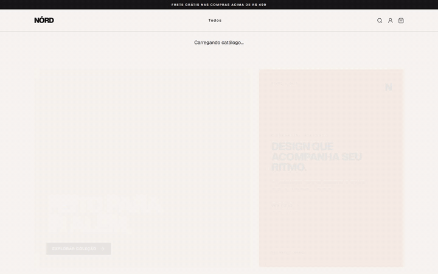
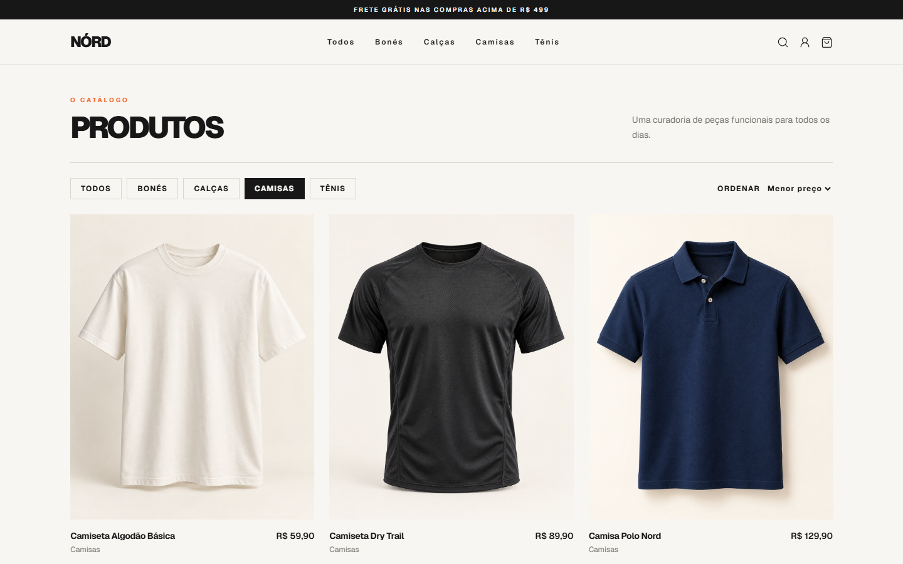
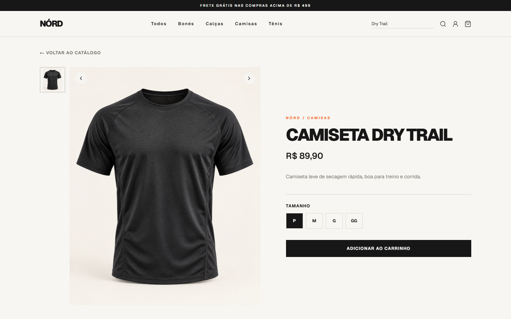
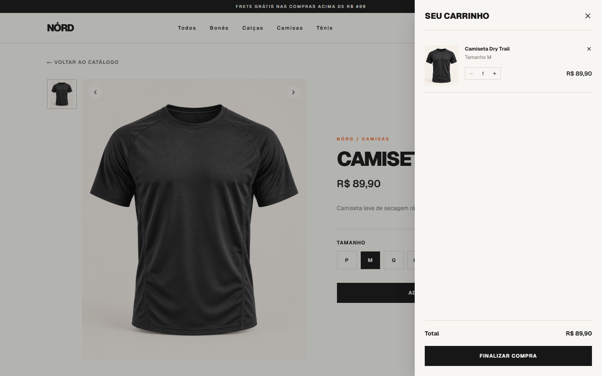
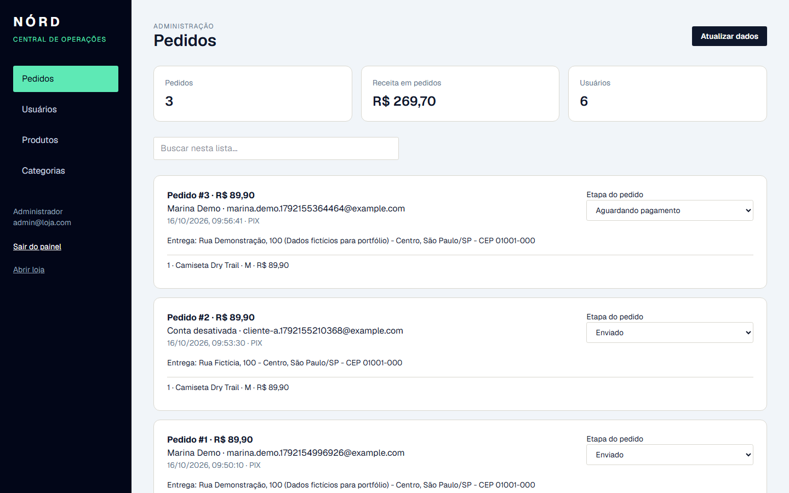
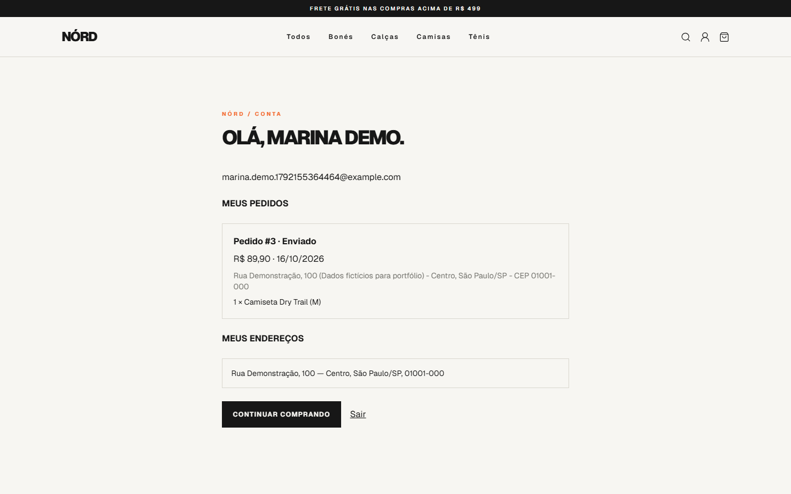
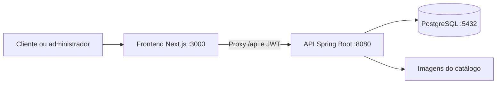

<div align="center">

# NÓRD · Storefront

**Uma jornada de compra conectada a uma API própria: do catálogo ao pedido, com gestão administrativa.**


[](https://github.com/ezequieldesr/nord_frontend/actions/workflows/ci.yml)
[](https://github.com/ezequieldesr/nord_frontend/actions/workflows/e2e.yml)

[Ver demonstração](#demonstração) · [Funcionalidades](#funcionalidades) · [Executar](#executar-localmente) · [Testes](#testes-e-gravação) · [API backend](https://github.com/ezequieldesr/nord_backend)

</div>

## O projeto

NÓRD é um e-commerce demonstrativo de moda desenvolvido como projeto pessoal de portfólio.
A interface usa dados reais da API: catálogo, autenticação, carrinho, endereços, pedidos e administração
são persistidos em PostgreSQL. O checkout registra pedidos fictícios, **sem efetuar cobranças**.

Este repositório contém o frontend. Para utilizar todas as funcionalidades, execute também o
[backend Nord](https://github.com/ezequieldesr/nord_backend) e o PostgreSQL.

## Demonstração

[](docs/demo/nord-demo.mp4)

**[▶ Jornada de compra e acompanhamento — MP4](docs/demo/nord-demo.mp4)** ·
**[▶ Gestão administrativa — MP4](docs/demo/nord-admin.mp4)**

As gravações foram produzidas pelo Playwright com a aplicação e o PostgreSQL locais,
sem simular respostas da API. Incluem legendas de etapas, navegação e verificações automáticas;
não possuem narração. [WebM da compra](docs/demo/nord-demo.webm) · [WebM da gestão](docs/demo/nord-admin.webm).
Os links abrem os arquivos; a reprodução depende do visualizador do GitHub ou do navegador.

<details>
<summary><strong>📷 Abrir galeria de telas</strong></summary>

| Catálogo | Detalhe do produto |
| --- | --- |
|  |  |

| Carrinho | Administração |
| --- | --- |
|  |  |



</details>

## Funcionalidades

| Para quem compra | Para quem administra |
| --- | --- |
| Vitrine e catálogo com imagens | Área própria em `/admin` |
| Categorias, busca e ordenação por preço | Login e sessão separados da loja |
| Detalhe, ampliação da imagem e tamanhos | Criação, edição e exclusão de produtos e categorias |
| Cadastro, login e perfil | Gestão de preços, tamanhos, imagens e estoque |
| Carrinho com quantidade, remoção e total da API | Consulta de pedidos, itens, cliente e endereço |
| Cadastro de endereço no checkout | Atualização da etapa do pedido |
| Pedido demonstrativo e histórico persistente | Edição, desativação e exclusão de usuários |

A API preserva usuários com pedidos e impede a exclusão da própria conta administrativa.
O cliente acompanha no perfil as alterações de status feitas no painel.
A busca e a ordenação do catálogo são locais, sobre dados carregados da API.

## Como os projetos se conectam



O navegador chama `/api/*` na origem do frontend. O Next encaminha as requisições ao endereço
`NORD_API_URL`, incluindo o header de autenticação. Essa variável é do servidor e não usa `NEXT_PUBLIC_`.

## Executar localmente

### Pré-requisitos

- Git, Node.js 24 e pnpm.
- Java 17 e Maven 3.9+ para a API.
- Docker Desktop com Compose, ou PostgreSQL configurado manualmente.
- Portas locais 3000, 8080 e 5432 disponíveis.

### 1. Obter os dois repositórios

```bash
git clone https://github.com/ezequieldesr/nord_backend.git
git clone https://github.com/ezequieldesr/nord_frontend.git
```

### 2. Iniciar banco e backend — terminal 1

```bash
cd nord_backend
docker compose up -d db
mvn spring-boot:run "-Dspring-boot.run.profiles=dev"
```

Aguarde o Docker Desktop iniciar antes do Compose. O perfil `dev` utiliza `loja_db` em `localhost:5432`,
usuário `postgres` e senha local `admin`. O perfil padrão é `prod` e exige variáveis de produção;
por isso o argumento `dev` é necessário. Na IDE, use `SPRING_PROFILES_ACTIVE=dev`.

### 3. Iniciar frontend — terminal 2

Na pasta `nord_frontend`, copie `.env.example` para `.env.local`.

```powershell
# Windows / PowerShell
Copy-Item .env.example .env.local
```

```bash
# Linux / macOS
cp .env.example .env.local
```

O conteúdo esperado é:

```dotenv
NORD_API_URL=http://127.0.0.1:8080
```

```bash
pnpm install --frozen-lockfile
pnpm dev
```

| Endereço | Uso |
| --- | --- |
| http://localhost:3000 | Loja |
| http://localhost:3000/admin | Painel administrativo |
| http://localhost:8080/api/produtos | API pública de produtos |

Cadastre uma conta na loja para experimentar o fluxo do cliente.

<details>
<summary><strong>Acessar o administrador local</strong></summary>

No perfil `dev`, o backend cria `admin@loja.com` com a senha `admin12345`.
Essas credenciais são exclusivamente de desenvolvimento. Nunca utilize essa senha online.
A URL separada organiza o painel; a autorização de cada operação é verificada na API.

</details>

<details>
<summary><strong>Usar PostgreSQL instalado em vez de Docker</strong></summary>

Inicie seu PostgreSQL e crie `loja_db`. Ajuste as propriedades de desenvolvimento via configuração
local ou variáveis `SPRING_DATASOURCE_URL`, `SPRING_DATASOURCE_USERNAME`, `SPRING_DATASOURCE_PASSWORD`.
Não inicie dois bancos na mesma porta. Não é necessário colocar o banco na internet para executar localmente.

</details>

## Testes e gravação

```bash
pnpm test                    # contratos da integração e sessões: 12 testes
pnpm typecheck               # TypeScript
pnpm build                   # compilação de produção
pnpm exec playwright install chromium
pnpm test:e2e                # 4 cenários com navegador/API reais
pnpm demo:record             # testes + vídeos com ritmo de apresentação
pnpm test:e2e:report          # relatório HTML local
```

Mantenha backend, banco e frontend em execução durante os testes E2E.
Para usar o build de produção no frontend, substitua `pnpm dev` por `pnpm build` e `pnpm start`.

| Cenário E2E | O que valida |
| --- | --- |
| Jornada de compra | Catálogo, conta, carrinho, endereço, pedido, estoque, persistência e atualização administrativa |
| Gestão | CRUD de categorias e produtos; alteração, desativação e exclusão de uma conta fictícia |
| API e permissões | 401/403, isolamento entre contas, limite de quantidade, revogação de token e preservação de histórico |
| Celular | Navegação e formulários em viewport 390 × 844 |

**Última execução documentada:** quatro cenários aprovados em 16/10/2026.
[Evidência resumida](docs/demo/verification.json) · [Roteiro, endpoints e pré-requisitos](docs/ROTEIRO-DEMONSTRACAO.md).

Os testes criam contas e pedidos fictícios e consomem estoque. Execute-os em banco local de demonstração,
com o catálogo de exemplo e estoque disponível. Não restauram o banco automaticamente.
As gravações reutilizáveis ficam em `docs/demo`; relatórios e traces com dados de sessão ficam fora do Git.

<details>
<summary><strong>Converter as gravações em MP4 e gerar a prévia GIF</strong></summary>

Com FFmpeg instalado e disponível no PATH:

```bash
pnpm demo:record
pnpm demo:export
```

Alternativamente, configure `FFMPEG_PATH` com o caminho do executável.
A gravação WebM não exige instalar FFmpeg separadamente: o Playwright instala seu gravador.
O MP4 e o GIF são derivados dos vídeos, sem reconstruir ou simular a interface.

</details>

## Organização

```text
app/                       Páginas / e /admin
components/storefront/     Loja, catálogo, conta, carrinho e checkout
components/admin-panel.tsx Painel administrativo
lib/                       Contratos, cliente da API e sessões independentes
e2e/                       Cenários Playwright com API real
scripts/                   Gravação e exportação dos vídeos
tests/                     Testes de contratos do cliente HTTP
docs/                      Roteiro, vídeos, capturas e evidência resumida
```

## Escopo e próximos passos

Este é um projeto de portfólio, sem gateway de pagamento, cobrança, frete calculado ou integração logística.
O aviso promocional de frete da vitrine é ilustrativo. O ícone de favoritos ainda não possui persistência.
Não há recuperação de senha nem confirmação de e-mail. Dados de cartão não são coletados.
As sessões usam `sessionStorage`; o logout local remove a sessão da aba, sem revogar por si só o JWT no servidor.
Alterações administrativas de usuário invalidam os tokens dessa conta.

Para uma operação comercial, os próximos passos incluem pagamento com webhooks, recuperação de conta,
observabilidade e evolução das proteções contra abuso. Testes de fluxo não substituem uma auditoria de segurança.

## Autor

[Ezequiel — GitHub](https://github.com/ezequieldesr)

[Voltar ao início](#nórd--storefront)


## Atualizações com GitHub Actions

Os workflows verificam testes, compilação, dependências e código com CodeQL.
O frontend também executa a integração Playwright com API e PostgreSQL descartáveis.
As actions são fixadas por commit e o Dependabot propõe atualizações semanalmente.
[Configuração dos checks e proteções de branch](docs/CI-SEGURANCA.md).
Os workflows só passam a executar no GitHub após o envio dos arquivos; regras de merge exigem configuração no repositório.
